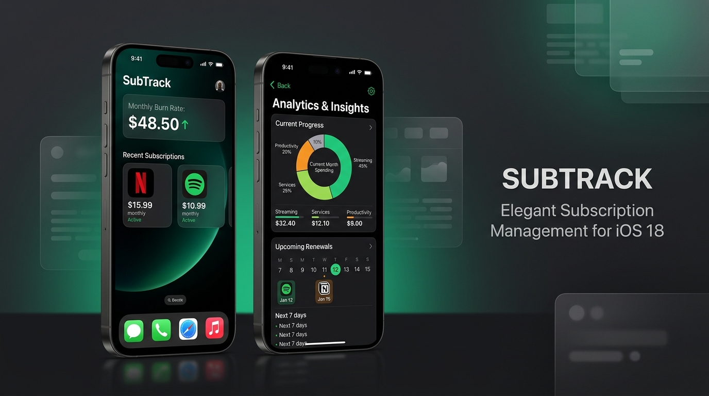
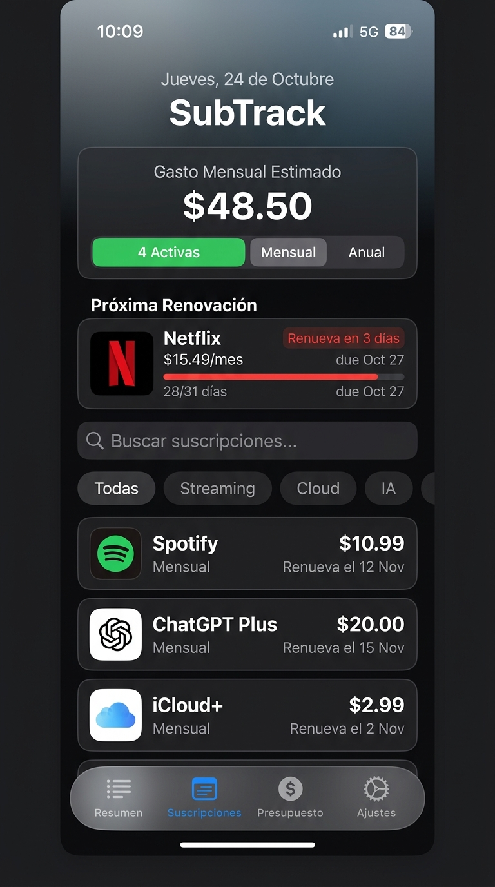
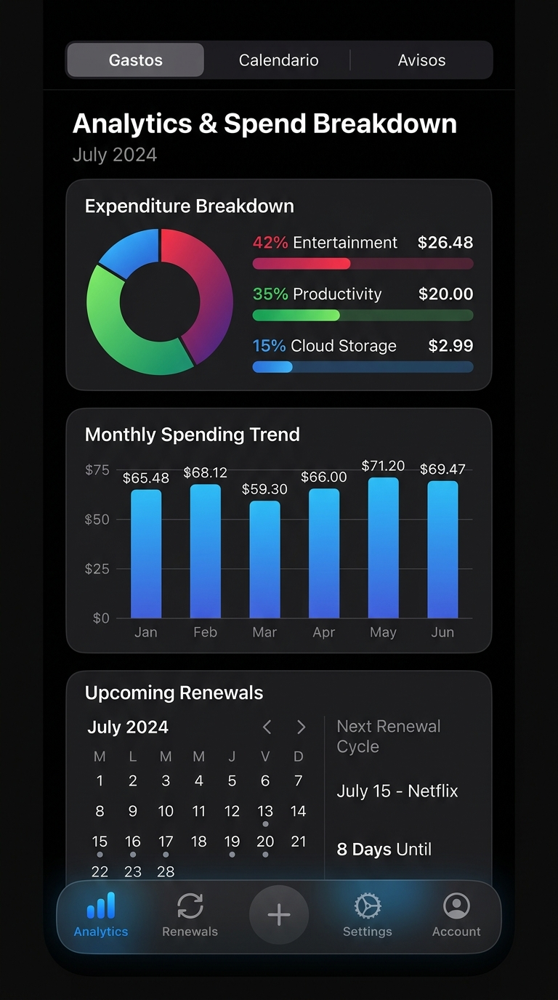
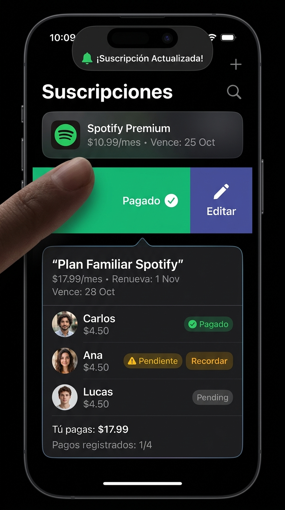

# SubTrack 📱💳

> **Elegant, privacy-first mobile subscription tracker designed to the iOS 27 Liquid Glass 2.0 and iPhone Duo foldable architecture.**  
> Track monthly burn rate, receive timely renewal alerts, organize subscriptions with dynamic brand icons, inspect dual-screen Arrangement Views, and retain 100% data sovereignty with zero cloud intermediaries.

[](https://developer.apple.com/)
[](https://developer.apple.com/)
[](https://react.dev/)
[](https://www.typescriptlang.org/)
[](https://tailwindcss.com/)
[](https://web.dev/progressive-web-apps/)
[](./security.md)

<br/>

<p align="center">
  
</p>

---

## 📸 Capturas de Pantalla / UI Showcase

<div align="center">
  <table>
    <tr>
      <td width="33%" align="center">
        
      </td>
      <td width="33%" align="center">
        
      </td>
      <td width="33%" align="center">
        
      </td>
    </tr>
    <tr>
      <td align="center">
        <b>📱 Panel Principal & Burn Rate</b><br/>
        <sub>Métricas en vivo, cuenta regresiva de vencimientos, chips de filtro y catálogo de 40+ logos oficiales.</sub>
      </td>
      <td align="center">
        <b>📊 Analítica & Calendario</b><br/>
        <sub>Distribución porcentual por categorías, gráficos de tendencias y centro de diagnóstico de alertas.</sub>
      </td>
      <td align="center">
        <b>⚡ Gestos Táctiles & Cuotas</b><br/>
        <sub>Deslizamiento rápido para pagar o editar, cálculo de planes familiares compartidos y Dynamic Island.</sub>
      </td>
    </tr>
  </table>
</div>

---

## ✨ Features at a Glance

### 💎 iOS 27 Liquid Glass 2.0 & Apple HIG Ergonomics
- **Liquid Glass 2.0 Materials (`.ios-27-glass`):** Translucent floating chrome with 210% saturation boost, 32px backdrop blur, subtle ambient depth shadow, and fine top hairline specular reflection (`border-white/20`).
- **Layer Separation Discipline:** Content cards remain solid, crisp, and high-contrast, reserving blur exclusively for floating functional chrome.
- **Strict 44pt Touch Targets:** Full compliance with Apple Human Interface Guidelines (`min-h-[44px]` / `min-w-[44px]`) across all buttons, tabs, and segmented controls.
- **Single-Word Terminology:** Simplified canonical navigation labels (`Suscripciones`, `Analítica`, `Ajustes`).
- **Accessibility Invariants:** Full media query fallbacks for `@media (prefers-reduced-transparency: reduce)` and `@media (prefers-contrast: more)`.
- **Safe Area Inset Support:** Uses `env(safe-area-inset-top)` and `env(safe-area-inset-bottom)` for notch, camera cutouts, and iPhone Home Bar.

### 📱 iPhone Duo Foldable Architecture & Arrangement View
- **Multi-Pose Device Switcher:** Instant top-bar toggle between **iPhone Pro** (`Smartphone`), **iPhone Duo** (`Columns2`), and **Fluido** (`Monitor`).
- **Dual-Display Arrangement View (`designing-for-iphone-duo.md`):**
  - **Left Display (Primary):** Live dashboard, monthly burn rate hero cards, instant search, category filter chips, and compact bottom dock.
  - **Center Titanium Hinge (`.iphone-duo-hinge`):** Authentic metallic folding spine with depth shadow and folding region support.
  - **Right Display (Secondary Companion):**
    - *When no subscription is selected:* Displays the **Radar de Suscripciones** with active statistics, total monthly burn rate, and interactive upcoming renewal timeline.
    - *When a subscription is clicked:* Instantly opens the full **SubscriptionDetailScreen** side-by-side, displaying payment history, invoice numbers, direct cancellation links, and immediate editing without losing the primary list position.

### 🏝️ Dynamic Island Live Activities
- **Floating Live Activity Capsule:** Interactive in-app notification banner (`InAppNotificationBanner.tsx`) styled after iOS 27 Dynamic Island with smooth spring physics transitions.
- **Pulsing Status Beacon:** Live green pulsating indicator and tabular countdown details.
- **Dual Feedback:** Accompanied by synthesized Web Audio chimes and tactile haptic vibration.

### ⚡ Fluid Swipe Gestures
- **Swipe Right (Emerald Track):** Instantly marks the current cycle as paid with dual-tone Web Audio chime, tactile vibration, and celebratory confetti particles.
- **Swipe Left (Indigo Track):** Opens the subscription edit sheet in a single flick.
- **Expandable Cards:** Tap any subscription to inspect detailed billing histories, cancellation direct links, and split-plan calculations.

### 🏷️ Dynamic Brand Icon Engine
- Bundled offline vector iconography via `react-icons` and `lucide-react` for **40+ premier services**:
  - *Streaming & Media:* Netflix, Spotify, YouTube Music, Disney+, Prime Video, Max, Twitch, Audible, Apple Music.
  - *AI & Productivity:* ChatGPT (OpenAI), Notion, GitHub, Figma, Adobe Creative Cloud, Dropbox, Slack, Microsoft 365.
  - *Cloud & Infrastructure:* AWS, Google Cloud, DigitalOcean, iCloud, Vercel, Supabase.
  - *Gaming & Lifestyle:* PlayStation Plus, Xbox Game Pass, Nintendo Switch Online, Duolingo, Strava.
- Automatic brand color matching on squircles with smooth category-themed fallbacks.

### 🔔 4-Tier Smart Notification Pipeline
1. **Dynamic Island Live Activity:** Instant in-app banner with spring physics and pulsing beacon.
2. **Web Audio Oscillator Chimes:** 0 KB synthesized dual-tone harmonic chimes (F6 1396Hz -> A6 1760Hz); no audio files to fetch.
3. **Tactile Vibration:** Short haptic pulses (`navigator.vibrate`) on supported mobile devices.
4. **Service Worker Push Alerts:** System notifications dispatched locally before renewal dates with deduplication prevention.

### 📊 Real-Time Financial Analytics & Renewal Calendar
- **Monthly Burn Rate Math:** Automatic normalization of weekly, monthly, quarterly, biannual, and annual billing frequencies.
- **Category Spend Distribution:** Visual percentage bars by category (Entertainment, Productivity, Cloud, etc.).
- **Interactive Calendar:** Visual month grid highlighting exact renewal dates and cost pills.

### 🔒 100% Client-Side Privacy & Data Sovereignty
- **Zero Cloud Storage:** All data resides exclusively in your browser's sandboxed `localStorage`.
- **Zero Registration:** Start tracking subscriptions immediately without passwords, emails, or bank credentials.
- **Zero Trackers:** No Google Analytics, no tracking beacons, no advertising cookies.
- **Data Portability:** 1-tap export/import of `.json` snapshots with merge/replace safety, plus RFC-5545 `.ics` Apple Calendar and Google Calendar sync links.

---

## 🚀 Quick Start

### Prerequisites
- Node.js 18+ (Node 20 or 22 recommended)
- npm or bun

### Installation & Development

```bash
# 1. Clone repository
git clone https://github.com/your-username/subtrack.git
cd subtrack

# 2. Install dependencies
npm install

# 3. Start local development server (runs on port 3000)
npm run dev
```

Open your browser at `http://localhost:3000`.

### Building for Production

```bash
# Build production bundle with Vite
npm run build

# Preview production build locally
npm run preview

# Verify TypeScript type-checking
npm run lint
```

---

## 📂 Project Architecture

```
├── public/
│   ├── favicon.svg             # SubTrack app icon
│   ├── manifest.json           # PWA web manifest
│   ├── pwa-192x192.png         # PWA home screen icon
│   ├── pwa-512x512.png         # PWA splash icon
│   └── sw.js                   # Service Worker (precache & push handler)
├── src/
│   ├── components/             # UI Components
│   │   ├── AddEditSubscriptionModal.tsx   # Add/Edit subscription sheet with Apple grabber
│   │   ├── AnalyticsNotificationScreen.tsx# Spend charts, calendar, & alert diagnostics
│   │   ├── BackupSyncScreen.tsx           # JSON backup/restore, calendar sync
│   │   ├── BottomNavBar.tsx               # iOS 27 compact Liquid Glass dock (44pt touch targets)
│   │   ├── DashboardScreen.tsx            # Main metrics, search & cards list
│   │   ├── GooglePlayCenterModal.tsx      # PWA/Play store packaging guidance
│   │   ├── InAppNotificationBanner.tsx    # iOS 27 Dynamic Island Live Activity banner
│   │   ├── OfflineIndicator.tsx           # Offline status pill
│   │   ├── PrivacyPolicyModal.tsx         # In-app privacy disclosure
│   │   ├── ServiceLogo.tsx                # Dynamic brand icon resolver (40+ brands)
│   │   ├── SubscriptionDetailScreen.tsx   # Detailed modal with history & cancel link
│   │   ├── SubTrackLogo.tsx               # Vector brand logomark & iconography
│   │   └── SwipeableSubscriptionCard.tsx  # Touch-friendly card with swipe actions
│   ├── utils/                  # Domain Utilities & Services
│   │   ├── backupService.ts               # JSON schema verification & export/import
│   │   ├── calendarExport.ts              # .ics file and Google Calendar generator
│   │   ├── categoryDetection.ts           # Keyword classifier & brand catalogs
│   │   ├── notificationService.ts         # Web Audio oscillator & push dispatcher
│   │   ├── subscriptionUtils.ts           # Monthly burn rate math & cycle advance
│   │   └── usePWAInstall.ts               # Hook for beforeinstallprompt event
│   ├── App.tsx                 # Root controller, multi-pose state, & Arrangement View
│   ├── index.css               # Tailwind CSS v4 variables & Liquid Glass 2.0 styling
│   ├── main.tsx                # React DOM entry point & Service Worker registration
│   └── types.ts                # TypeScript interfaces & domain models
├── architecture.md             # Detailed technical architecture specification
├── rules.md                    # Engineering & Apple HIG guidelines
├── security.md                 # Security architecture, privacy, & threat model
├── memory.md                   # Chronological project evolution log
├── prd.md                      # Product Requirements Document
├── product.md                  # Product Strategy & Feature Roadmap
└── tasks.md                    # Task backlog & completion status
```

---

## 🔄 Historial de Actualizaciones / Changelog

### 🚀 v2.7.0 — Edición iOS 27 & iPhone Duo (Actual)
- **Pantalla Dual Plegable iPhone Duo:** Soporte nativo para el estándar de hardware plegable de Apple (`designing-for-iphone-duo.md`). Selector multi-postura en la cabecera superior:
  - **iPhone Pro** (`Smartphone`): marco insignia clásico de pantalla única.
  - **iPhone Duo** (`Columns2`): chasis de pantalla doble con bisagra central de titanio (`.iphone-duo-hinge`).
  - **Fluido** (`Monitor`): presentación responsive full-width para navegadores de escritorio y tablets.
- **Arrangement View Interactiva:** En postura Duo, la app despliega una experiencia de doble pantalla simultánea:
  - **Pantalla Izquierda (Primaria):** Lista interactiva de suscripciones, tarjetas resumen de burn rate mensual, buscador instantáneo, chips de categoría y dock de navegación.
  - **Bisagra Central de Titanio:** Acabado metálico con shader de profundidad y respeto al área reservada de plegado.
  - **Pantalla Derecha (Secundaria / Companion):** Muestra el **Radar de Renovaciones en Tiempo Real** (estadísticas vivas, burn rate y timeline de próximos vencimientos) o la **Ficha de Detalle de la Suscripción seleccionada** con historial de pagos, recibos y edición inmediata sin perder la lista principal.
- **Materiales Liquid Glass 2.0:** Nuevas clases `.ios-27-glass` con realce cromático de saturación al 210%, desenfoque de 32px y biselado especular superior (`border-white/20`).
- **Dynamic Island Live Activities:** Rediseño de la cápsula de alertas con baliza de estado en verde pulsante, animaciones elásticas y retroalimentación táctil simultánea.
- **Micro-Dock Ergonómico:** Barra de pestañas ultracompacta (`h-[50px]`) con etiquetas simplificadas de una sola palabra (`Suscripciones`, `Analítica`, `Ajustes`) y touch targets de 44pt.
- **Documentación Técnica Completa:** Sincronización y publicación de `architecture.md`, `rules.md`, `security.md`, `memory.md` y capturas de alta resolución en `docs/screenshots/`.

### ⚡ v2.0.0 — Gestos Swipe Táctiles & Logos de Marcas Oficiales
- Catálogo indexado de 40+ servicios globales con logos SVG vectoriales e integración de `lucide-react` y `react-icons`.
- Gestos swipe táctiles: Deslizar a la derecha para "Marcar Pagado" (con haptics, sintetizador Web Audio y confeti) y a la izquierda para editar.
- Centro de diagnósticos y pruebas de notificaciones del sistema en vivo con verificación de Service Worker y permisos.
- Modos Claro y Oscuro nativos con persistencia en `localStorage`.

---

## 📲 Installing as a PWA

SubTrack functions as a standalone Progressive Web App without needing an app store download:

### On iOS (iPhone / iPad)
1. Open the app in **Safari**.
2. Tap the **Share** button (box with an arrow pointing up) at the bottom.
3. Scroll down and select **"Add to Home Screen"** (`Agregar a inicio`).
4. Tap **Add**. SubTrack will launch full-screen with native gestures and no browser URL bar.

### On Android
1. Open the app in **Chrome**.
2. Tap the three dots menu in the top right.
3. Tap **"Install App"** or **"Add to Home Screen"**.

### On Desktop (macOS / Windows / Linux)
1. In Chrome, Edge, or Brave, click the **Install** icon in the address bar.

---

## 📚 Documentation Index

For in-depth technical details, please consult our dedicated documentation:

| Document | Purpose |
|---|---|
| 📐 [architecture.md](./architecture.md) | Component hierarchy, data flow, Web Audio synthesis, and Service Worker caching. |
| 🛡️ [security.md](./security.md) | Threat modeling, zero-telemetry guarantees, safe JSON deserialization, and privacy compliance. |
| 📏 [rules.md](./rules.md) | Coding conventions, strict TypeScript rules, and Apple HIG 44pt touch standards. |
| 🧠 [memory.md](./memory.md) | Chronological development log, user directives, and architectural trade-offs. |
| 📋 [prd.md](./prd.md) | Core requirements and user stories. |
| 🚀 [product.md](./product.md) | Product strategy, feature tiers, and competitive positioning. |
| ✅ [tasks.md](./tasks.md) | Engineering roadmap and implementation checklist. |

---

## 📄 License & Privacy

SubTrack is released under the **MIT License**. Your financial data never leaves your device.
